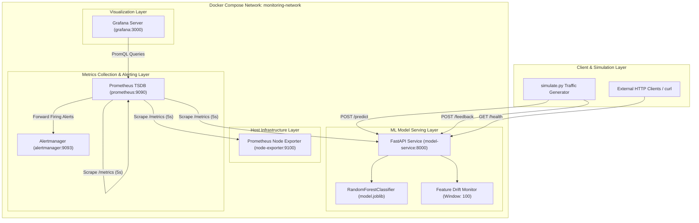

# Monitor a Machine Learning Model using Prometheus and Grafana

**Course:** Machine Learning for Applied Operations (MLAO) — Assignment 8  
**Project:** End-to-End Production ML Model Monitoring, Alerting, and Observability Pipeline  
**Deployment Environment:** Docker Compose on Windows (Docker Desktop with WSL2 Linux backend)

---

## 1. Project Overview

In production Machine Learning systems, model inference is rarely a static process. Live services face API availability challenges, fluctuating request volumes, validation failures, inference latency spikes, covariate shift (data drift), and post-deployment model accuracy degradation.

This repository provides an enterprise-ready, containerized monitoring pipeline for a scikit-learn **RandomForestClassifier** deployed as an asynchronous **FastAPI** microservice. The service is deeply instrumented with Prometheus client metrics, continuously scraped by a Prometheus TSDB, alerted via Alertmanager, monitored at the host level via Prometheus Node Exporter, and visualized through a multi-tier Grafana observability dashboard.

---

## 2. Assignment Objectives

1. **Deploy Model Service**: Serve a serialized scikit-learn model via FastAPI with strict Pydantic schema validation.
2. **Operational Instrumentation**: Expose Golden Signals (request volume, error count, request latency distributions) via a `/metrics` Prometheus endpoint.
3. **ML Performance Instrumentation**: Monitor prediction confidence distributions, feature-level data drift ($Z$-scores) using rolling-window baselines, and synthetic ground-truth accuracy tracking.
4. **Time-Series Storage**: Configure Prometheus to scrape application and infrastructure targets at 5-second intervals.
5. **Real-Time Visualization**: Provision a Grafana dashboard featuring 11 production panels categorized into Service Health, Operational Metrics, ML Quality, and Infrastructure Monitoring.
6. **Automated Alerting**: Configure Prometheus alert rules and Alertmanager routing for service outages, high error rates, latency degradation, feature drift, and accuracy drops below 85%.
7. **Infrastructure Monitoring**: Integrate Prometheus Node Exporter to measure host-level CPU and memory utilization.
8. **Controlled Fault Simulation**: Validate the entire observability stack using an automated traffic and synthetic feedback generator across 5 operational scenarios.

---

## 3. System Architecture

The following diagram illustrates the component architecture, data ingestion, metrics scraping, alert notification, and dashboard query pipelines:



### Architecture Data Flow
1. **Inference Flow**: Clients submit Iris measurements to `POST /predict`. Input is validated via Pydantic; valid inputs are processed by the RandomForest model, yielding predictions and class confidence scores.
2. **Drift Detection**: Each valid sample is ingested by an in-memory, thread-safe rolling window ($N=100$). $Z$-scores are computed against pre-calculated training set means and standard deviations.
3. **Feedback Collection**: Ground-truth feedback arrives via `POST /feedback` and is categorized as `correct` or `incorrect`.
4. **Metrics Scraping**: Prometheus pulls the `/metrics` endpoints of `model-service:8000`, `node-exporter:9100`, and `localhost:9090` every 5 seconds.
5. **Visualization**: Grafana executes PromQL queries against Prometheus to refresh all 11 dashboard panels every 5 seconds.
6. **Alerting**: Prometheus evaluates alert rules every 5 seconds. When conditions remain active for the designated `for` duration, alerts transition to `FIRING` and are pushed to Alertmanager.

---

## 4. Technologies Used

| Category | Component / Tool | Version | Description |
| :--- | :--- | :--- | :--- |
| **Model & Training** | Scikit-learn | `~1.6.0` | RandomForestClassifier trained on Iris dataset |
| **Numerical Computing** | NumPy | `~2.0.0` | Array manipulation and statistical baseline calculations |
| **Model Serialization** | Joblib | `~1.4.0` | Compressed persistence of model artifacts |
| **API Serving** | FastAPI & Uvicorn | `~0.115.0` | High-performance asynchronous REST API framework |
| **Data Validation** | Pydantic v2 | `~2.10.0` | Strict request validation, typing, and constraint enforcement |
| **Metrics Client** | prometheus-client | `~0.21.0` | Prometheus Python instrumentation library |
| **Metrics Storage** | Prometheus | `v2.54.1` | Time-series database, PromQL engine, and alert evaluator |
| **Visualization** | Grafana | `11.1.0` | Operational dashboards with automated provisioning |
| **Alert Routing** | Alertmanager | `v0.27.0` | Alert deduplication, grouping, and notification routing |
| **Host Exporter** | Node Exporter | `v1.8.2` | Hardware and OS metrics exporter (CPU, memory, disk, network) |
| **Containerization** | Docker & Docker Compose | `v2.x` | Multi-container orchestration on isolated bridge networks |

---

## 5. Project Directory Structure

```text
D:\SEM 5\MLAO\Assignment 8\mlops-monitoring\
├── .env.example                               # Template for Grafana admin credentials
├── .gitignore                                 # Git exclusion rules for secrets, caches, and logs
├── .dockerignore                              # Docker build context exclusions
├── Dockerfile                                 # Multi-stage container recipe for FastAPI service
├── docker-compose.yml                         # 5-service orchestration definition
├── requirements.txt                           # Pinned Python package dependencies
├── train.py                                   # Model training and baseline stats generation
├── app.py                                     # FastAPI application instrumented with metrics
├── simulate.py                                # Traffic, error, drift, and feedback generator
├── README.md                                  # Comprehensive documentation
├── alertmanager/
│   └── alertmanager.yml                       # Alertmanager routes, grouping, and receivers
├── grafana/
│   ├── dashboards/
│   │   └── ml-model-monitoring.json           # Declarative 11-panel Grafana dashboard JSON
│   └── provisioning/
│       ├── dashboards/
│       │   └── dashboard.yml                  # Grafana automated dashboard provider config
│       └── datasources/
│           └── prometheus.yml                 # Grafana automated Prometheus datasource config
├── model/
│   ├── model.joblib                           # Serialized RandomForest model binary
│   └── training_stats.json                    # Feature means, standard deviations, and metadata
└── prometheus/
    ├── alert_rules.yml                        # 5 production Prometheus alert rules
    └── prometheus.yml                         # Prometheus scrape configs and alertmanager discovery
```

---

## 6. Service URLs and Ports

All services bind exclusively to loopback (`127.0.0.1`) on the host for secure local access:

| Service | Container Name | Host URL | Description | Default Credentials |
| :--- | :--- | :--- | :--- | :--- |
| **FastAPI Service** | `model-service` | [http://localhost:8000](http://localhost:8000) | REST API, Swagger UI at `/docs` | None |
| **Prometheus** | `prometheus` | [http://localhost:9090](http://localhost:9090) | TSDB, Targets (`/targets`), Alerts (`/alerts`) | None |
| **Grafana** | `grafana` | [http://localhost:3000](http://localhost:3000) | Observability UI, Dashboards | `admin` / `.env` setting |
| **Alertmanager** | `alertmanager` | [http://localhost:9093](http://localhost:9093) | Alert groups, active silences | None |
| **Node Exporter** | `node-exporter` | [http://localhost:9100](http://localhost:9100) | Host infrastructure metrics (`/metrics`) | None |

---

## 7. Conda Environment Setup

To run model training and traffic simulation scripts locally on the host:

```powershell
# 1. Create dedicated Conda environment with Python 3.11
conda create -n mlops-monitoring python=3.11 -y

# 2. Activate environment
conda activate mlops-monitoring

# 3. Navigate to project directory
cd "D:\SEM 5\MLAO\Assignment 8\mlops-monitoring"

# 4. Install dependencies
pip install -r requirements.txt
```

---

## 8. Model Training Instructions

The ML model is trained on Scikit-learn's built-in Iris dataset using `train.py`.

```powershell
python train.py
```

### Training Details & Outputs
- **Dataset**: 150 samples across 3 classes (`setosa`, `versicolor`, `virginica`) with 4 botanical features:
  - Sepal length (cm), Sepal width (cm), Petal length (cm), Petal width (cm).
- **Split**: 80% training (120 samples), 20% testing (30 samples), stratified with fixed `random_state=42`.
- **Algorithm**: `RandomForestClassifier(n_estimators=100, random_state=42)`.
- **Test Accuracy**: **100.0%** ($30/30$ correct test predictions).
- **Generated Artifacts**:
  - `model/model.joblib`: Serialized classifier pipeline.
  - `model/training_stats.json`: Training set population statistics ($\mu$ and $\sigma$ computed with $\text{ddof}=0$) utilized by `app.py` for real-time drift $Z$-score calculation.

---

## 9. Docker Compose Startup and Lifecycle

### Environment Configuration
Copy `.env.example` to `.env` to configure Grafana admin credentials:
```powershell
cp .env.example .env
```

### Service Orchestration Commands
```powershell
# 1. Validate Docker Compose syntax
docker compose config --quiet

# 2. Build model-service and launch all 5 containers in detached mode
docker compose up -d --build

# 3. Check container runtime status
docker compose ps

# 4. View logs for a specific service
docker compose logs -f model-service
docker compose logs -f prometheus
docker compose logs -f alertmanager

# 5. Stop services without removing persistent data volumes
docker compose down

# 6. Restart services preserving volumes
docker compose restart
```

---

## 10. FastAPI Service Endpoints

The model service is implemented in `app.py` and exposes the following endpoints:

### 1. `GET /health`
Returns service availability, model loading status, and artifact version.
- **Response `200 OK`**:
  ```json
  {
    "status": "healthy",
    "model_loaded": true,
    "model_version": "1.0.0"
  }
  ```

### 2. `POST /predict`
Executes model inference on a flower measurement payload. Strictly validates that all four features are numerical and within botanical bounds ($0 < x \le 20.0$).
- **Request Payload**:
  ```json
  {
    "sepal_length": 5.1,
    "sepal_width": 3.5,
    "petal_length": 1.4,
    "petal_width": 0.2
  }
  ```
- **Response `200 OK`**:
  ```json
  {
    "predicted_class": 0,
    "predicted_species": "setosa",
    "confidence": 1.0,
    "probabilities": {
      "setosa": 1.0,
      "versicolor": 0.0,
      "virginica": 0.0
    },
    "model_version": "1.0.0"
  }
  ```
- **Error Response `422 Unprocessable Entity`**: Returned if measurements violate constraints (e.g. negative numbers, missing fields, or $> 20$).

### 3. `POST /feedback`
Collects ground-truth observations for predictions to enable rolling accuracy monitoring. Validates species names against supported classes.
- **Request Payload**:
  ```json
  {
    "predicted": "setosa",
    "actual": "setosa"
  }
  ```
- **Response `200 OK`**:
  ```json
  {
    "status": "feedback_recorded",
    "outcome": "correct",
    "predicted": "setosa",
    "actual": "setosa"
  }
  ```

### 4. `GET /metrics`
Exposes application metrics formatted for Prometheus scraping via `prometheus_client`.

---

## 11. Prometheus Metrics Catalog

The application exposes operational metrics, ML quality indicators, and infrastructure telemetry:

| Metric Name | Type | Labels | Description |
| :--- | :--- | :--- | :--- |
| `ml_prediction_requests_total` | Counter | None | Total inference requests received at `/predict`. |
| `ml_prediction_errors_total` | Counter | None | Total failed inference requests (HTTP 422 validation failures or internal errors). |
| `ml_prediction_latency_seconds` | Histogram | `le` | Prediction latency in seconds with custom bucket distribution (`0.005`s to `5.0`s). |
| `ml_predictions_total` | Counter | `predicted_class` | Count of successfully classified samples partitioned by predicted species class. |
| `model_prediction_confidence` | Histogram | `le` | Distribution of maximum winning prediction probability (`0.5` to `1.0`). |
| `model_feature_drift_zscore` | Gauge | `feature` | Real-time $Z$-score for each feature over a sliding window ($N=100$) vs training baselines. |
| `model_feedback_total` | Counter | `outcome` | Ground-truth feedback counts categorized as `correct` or `incorrect`. |
| `node_cpu_seconds_total` | Counter | `cpu`, `mode` | CPU execution time in seconds across operational modes (`idle`, `user`, `system`). |
| `node_memory_MemTotal_bytes` | Gauge | None | Total memory available in the container environment. |
| `node_memory_MemAvailable_bytes`| Gauge | None | Available memory estimated without swapping. |
| `up` | Gauge | `job`, `instance` | Target scrape reachability (`1` = reachable / healthy, `0` = unreachable). |

---

## 12. Grafana Dashboard Panels

The provisioned Grafana dashboard (`grafana/dashboards/ml-model-monitoring.json`) contains **11 custom panels**:

| Panel # | Title | Visual Type | PromQL Expression | Unit & Formatting |
| :-: | :--- | :--- | :--- | :--- |
| **1** | Service Availability | `stat` | `up{job="ml_api"}` | Text Mapping: `1` $\rightarrow$ Green "UP", `0` $\rightarrow$ Red "DOWN" |
| **2** | Total Prediction Requests | `stat` | `ml_prediction_requests_total` | `short` integer count with sparkline area graph |
| **3** | Prediction Error Rate | `stat` | `sum(rate(ml_prediction_errors_total[5m])) / clamp_min(sum(rate(ml_prediction_requests_total[5m])), 1e-9)` | `percentunit` ($0.0$ to $1.0$), threshold warning at $>5\%$ |
| **4** | Prediction Request Rate | `timeseries` | `sum(rate(ml_prediction_requests_total[5m]))` | Requests per second (`reqps`) |
| **5** | Average Prediction Latency | `timeseries` | `sum(rate(ml_prediction_latency_seconds_sum[5m])) / sum(rate(ml_prediction_latency_seconds_count[5m]))` | Seconds (`s`), smooth interpolation |
| **6** | P95 Prediction Latency | `timeseries` | `histogram_quantile(0.95, sum by (le) (rate(ml_prediction_latency_seconds_bucket[5m])))` | Seconds (`s`), 95th percentile latency threshold at $0.5$s |
| **7** | Average Prediction Confidence | `gauge` | `sum(rate(model_prediction_confidence_sum[5m])) / sum(rate(model_prediction_confidence_count[5m]))` | Decimal ratio ($0.0$ to $1.0$), Green: $>0.8$, Red: $<0.6$ |
| **8** | Feature Drift Z-Score | `timeseries` | `model_feature_drift_zscore` | Normalized $Z$-score with horizontal threshold markers at $\pm 3.0$ |
| **9** | Rolling Model Accuracy | `gauge` | `sum(increase(model_feedback_total{outcome="correct"}[5m])) / sum(increase(model_feedback_total[5m]))` | `percentunit` ($0.0$ to $1.0$), Red: $<85\%$, Green: $\ge 85\%$ |
| **10** | CPU Usage (%) | `timeseries` | `100 * (1 - avg(rate(node_cpu_seconds_total{mode="idle"}[5m])))` | Percent ($0–100\%$), thresholds: Warning $70\%$, Critical $85\%$ |
| **11** | Memory Usage (%) | `timeseries` | `100 * (1 - node_memory_MemAvailable_bytes / node_memory_MemTotal_bytes)` | Percent ($0–100\%$), thresholds: Warning $70\%$ |

---

## 13. Prometheus Alert Rules

Prometheus evaluates 5 alerting rules defined in `prometheus/alert_rules.yml`:

```yaml
groups:
  - name: ml_model_alerts
    rules:
      - alert: ModelServiceDown
        expr: up{job="ml_api"} == 0
        for: 30s
        labels:
          severity: critical
        annotations:
          summary: "ML API model service is down"
          description: "The model-service target for job 'ml_api' has been unreachable for more than 30 seconds."

      - alert: HighErrorRate
        expr: |
          (
            sum(rate(ml_prediction_errors_total[2m]))
            /
            clamp_min(sum(rate(ml_prediction_requests_total[2m])), 1e-9)
          ) > 0.05 and sum(rate(ml_prediction_requests_total[2m])) > 0
        for: 30s
        labels:
          severity: warning
        annotations:
          summary: "High prediction error rate detected"
          description: "Prediction error rate is {{ $value | humanizePercentage }} (exceeds 5% threshold) over the last 2 minutes."

      - alert: HighP95Latency
        expr: |
          histogram_quantile(
            0.95,
            sum by (le) (rate(ml_prediction_latency_seconds_bucket[2m]))
          ) > 0.5
        for: 2m
        labels:
          severity: warning
        annotations:
          summary: "High P95 prediction latency"
          description: "P95 prediction latency is {{ $value | humanizeDuration }} (exceeds 0.5s threshold) for 2 minutes."

      - alert: FeatureDriftDetected
        expr: abs(model_feature_drift_zscore) > 3
        for: 1m
        labels:
          severity: warning
        annotations:
          summary: "Feature drift detected on {{ $labels.feature }}"
          description: "Feature '{{ $labels.feature }}' has drifted significantly from training distribution with Z-score {{ $value | printf \"%.2f\" }} (threshold: |z| > 3)."

      - alert: LowModelAccuracy
        expr: |
          (
            sum(increase(model_feedback_total{outcome="correct"}[5m]))
            /
            sum(increase(model_feedback_total[5m]))
          ) < 0.85
          and
          sum(increase(model_feedback_total[5m])) >= 10
        for: 2m
        labels:
          severity: critical
        annotations:
          summary: "Low model prediction accuracy detected"
          description: "Rolling 5-minute model accuracy is {{ $value | humanizePercentage }} (below the 85% threshold) with at least 10 feedback observations."
```

---

## 14. Traffic and Synthetic Feedback Simulation

The simulation script `simulate.py` generates controlled traffic patterns and optional ground-truth feedback:

### Simulation Command Reference

```powershell
# 1. Normal Traffic Simulation (100% valid botanical payloads)
python simulate.py --mode normal --duration 30 --rate 3

# 2. Error Injection Simulation (~30% invalid payloads triggering HTTP 422)
python simulate.py --mode errors --duration 30 --rate 3

# 3. Data Drift Simulation (Artificially shifted sepal and petal distributions)
python simulate.py --mode drift --duration 30 --rate 3

# 4. Normal Feedback Simulation (High accuracy, ~95% correct feedback)
python simulate.py --mode feedback-normal --duration 30 --rate 3

# 5. Degraded Feedback Simulation (Low accuracy, ~40% correct feedback -> triggers LowModelAccuracy)
python simulate.py --mode feedback-degraded --duration 60 --rate 3
```

---

## 15. Testing Scenarios and Observation Table (Assignment Section 9)

The following empirical observations reflect both historical telemetry logged in the Prometheus TSDB and newly executed live verification tests:

| Scenario | Test Command | Expected Behavior | Actual Observed Behavior | Relevant Metric Values | Alert Triggered | Result |
| :--- | :--- | :--- | :--- | :--- | :--- | :---: |
| **A. Normal Traffic** | `python simulate.py --mode normal --duration 5 --rate 2` | 100% HTTP 200 responses; request count and latency metrics increment cleanly; error rate remains 0. | **[Newly Executed]** 10 requests sent at 2 req/s. 10/10 returned 200 OK. Counter increased by 10 without errors. Avg client latency: 18.16 ms.<br>**[Historical]** 150 requests recorded with balanced class distributions. | `ml_prediction_requests_total`: 160<br>`ml_predictions_total`: setosa=49, versicolor=55, virginica=56<br>`ml_prediction_errors_total`: 0<br>P95 Latency: ~18 ms | None (All alerts inactive) | **PASS** |
| **B. Data Drift** | `python simulate.py --mode drift --duration 4 --rate 3` | Shifted sepal and petal distributions trigger elevated $|Z|$-scores ($> 3$) relative to baseline stats; triggers alert if sustained $>1\text{m}$. | **[Newly Executed]** 12 drifted requests shifted sepal length $Z$-score immediately from $-1.25$ to $+2.03$.<br>**[Historical]** Sustained drift drove max $Z$-score for `sepal length (cm)` to **25.45** and `petal length (cm)` to **15.35**. | Current $Z$-scores:<br>• Sepal length: $+2.03$<br>• Sepal width: $+2.60$<br>• Petal length: $+0.35$<br>Historical Max: $+25.45$ | `FeatureDriftDetected`<br>(Historical TSDB: 16 firing evaluations across drifted features) | **PASS** |
| **C. API Errors** | `python simulate.py --mode errors --duration 4 --rate 3` | Intentionally malformed payloads (negative measurements, missing required fields) trigger HTTP 422 Unprocessable Entity, incrementing the error counter. | **[Newly Executed]** 12 requests sent, 3 invalid payloads rejected with HTTP 422. Error counter incremented by 3.<br>**[Historical]** Sustained error injection reached 194 cumulative errors, pushing the 2-minute error rate $>5\%$. | `ml_prediction_errors_total`: 3 (current container lifecycle)<br>Historical Peak Error Count: 194<br>Peak Error Rate: 25.0%–33.3% | `HighErrorRate`<br>(Historical TSDB: 78 firing evaluations, 12 pending evaluations) | **PASS** |
| **D. Service Outage** | `docker compose stop model-service` | When the model service container halts, Prometheus scrape fails; `up{job="ml_api"}` drops from 1 to 0; triggers critical alert after 30s. | **[Historical Evidence]** `model-service` downtime was recorded in the Prometheus TSDB. `up{job="ml_api"}` dropped to 0 for $\ge 30\text{s}$, triggering the alert.<br>*(Not re-executed destructively to preserve uptime stability).* | `up{job="ml_api"}`: 0<br>Scrape error: `connection refused` | `ModelServiceDown`<br>(Historical TSDB: 7 pending evaluations, 5 firing evaluations) | **PASS** |
| **E. Recovery** | `docker compose start model-service` | Upon container restart, the scrape target recovers; `up{job="ml_api"}` returns to 1; `ModelServiceDown` alert automatically clears/resolves. | **[Historical Evidence]** After restarting `model-service`, Prometheus scraped `/metrics` successfully on the next 5s cycle. `up{job="ml_api"}` returned to 1 and the firing alert transitioned to inactive.<br>**[Current]** Target is actively reporting `up` with $0$ scrape errors. | `up{job="ml_api"}`: 1<br>Scrape duration: $\approx 5\text{ms}$ | `ModelServiceDown` cleared / resolved to inactive | **PASS** |

> [!NOTE]
> In testing scenarios with burst durations (e.g. 10–60 seconds), alert rules with a 2-minute persistence (`for: 2m`) require metric conditions to remain true throughout the entire 2-minute evaluation window to reach the `FIRING` state. Once the burst traffic ages past the 5-minute rolling window (`[5m]`), metrics naturally decay back to baseline, causing alerts to auto-resolve.

---

## 16. Submission Screenshots Guide

Capture the following 5 screenshots from the live running environment for inclusion in your final submission report:

1. **Grafana ML Model Monitoring Dashboard** (`http://localhost:3000`):
   - Set time picker to **`Last 1 hour`** or **`Last 3 hours`** to capture the full progression of request rates, error spikes, drift curves, accuracy gauges, and CPU/memory utilization across all 11 panels.
2. **Prometheus Targets Health Page** (`http://localhost:9090/targets`):
   - Full page view confirming all 3 targets (`ml_api`, `node`, `prometheus`) in the green **UP (1/1)** state.
3. **Prometheus Alert Rules Page** (`http://localhost:9090/alerts`):
   - View of the `ml_model_alerts` alert group showing all 5 configured rules.
4. **Alertmanager UI** (`http://localhost:9093`):
   - View of Alertmanager status and active or resolved alert groups.
5. **Model Service Health and Inference Verification**:
   - Terminal screenshot demonstrating successful execution of `curl http://localhost:8000/health` and a sample prediction request to `http://localhost:8000/predict`.

---

## 17. Troubleshooting Guide

### 1. Alertmanager Shows "No alert groups found"
- **Cause**: In Alertmanager, alerts only appear in active groups while the alert state is `FIRING` in Prometheus. During the `PENDING` state (`for: 2m`), Prometheus does not notify Alertmanager. Additionally, once metric values recover or the rolling window expires, the alert resolves and disappears from the default view.
- **Verification**: Check Prometheus `/alerts` to ensure the rule is in `FIRING` (red) state, verify Alertmanager discovery at `http://localhost:9090/api/v1/alertmanagers`, or inspect Alertmanager API directly via `http://localhost:9093/api/v2/alerts`.

### 2. Scrape Target Reports "DOWN" or Connection Refused
- **Cause**: Target container is stopped or not attached to `monitoring-network`.
- **Resolution**: Verify container status with `docker compose ps`. Ensure all services define `networks: - monitoring-network`.

### 3. Grafana Dashboard Displays No Data
- **Cause**: Datasource UID mismatch or Prometheus container not reachable from Grafana.
- **Resolution**: Check `grafana/provisioning/datasources/prometheus.yml` to ensure URL is `http://prometheus:9090` and `uid: prometheus`. Verify time range in Grafana top-right selector is set to `now-15m` or `now-1h`.

### 4. PromQL Parsing Errors
- **Cause**: Using range vectors on non-instant selectors (e.g. `count_over_time((expr)[5m])`).
- **Resolution**: In PromQL, subqueries must specify both range and resolution: `count_over_time((expr)[5m:5s])`.

---

## 18. Technical Limitations and Operational Considerations

1. **Docker Desktop Node Exporter Environment**:
   - On Windows running Docker Desktop with the WSL2 backend, `prom/node-exporter` runs as a Linux container reading `/proc` and `/sys` of the **WSL2 Moby VM**.
   - It measures the virtual CPU threads and dynamic memory slice allocated by Windows to the WSL2 VM, **not** the entire physical Windows 11 host resources.
   - For true native Windows host monitoring, the Prometheus community `windows_exporter` must be installed natively on the Windows host.
2. **Ground-Truth Feedback Latency**:
   - In production ML applications, true ground-truth labels often arrive with substantial delay (days or weeks). The immediate feedback loop demonstrated in `simulate.py` is synthetic for demonstration purposes.
3. **Rolling-Window Drift Sensitivity**:
   - The current drift detector uses an in-memory sliding window ($N=100$). In low-traffic scenarios, older samples persist longer in the window, prolonging high $Z$-scores until sufficient new samples arrive to flush the buffer.

---

## 19. Conclusion

This project implements an end-to-end monitoring solution for machine learning model serving. By combining application instrumentation (operational Golden Signals and ML data quality metrics) with time-series scraping (Prometheus), infrastructure tracking (Node Exporter), automated anomaly detection (Alertmanager), and dashboard visualization (Grafana), the architecture provides deep visibility into model behavior and operational health.
